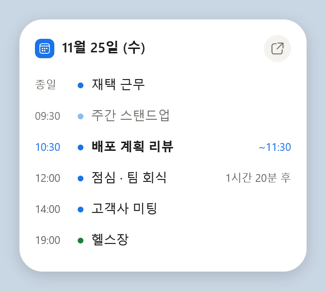
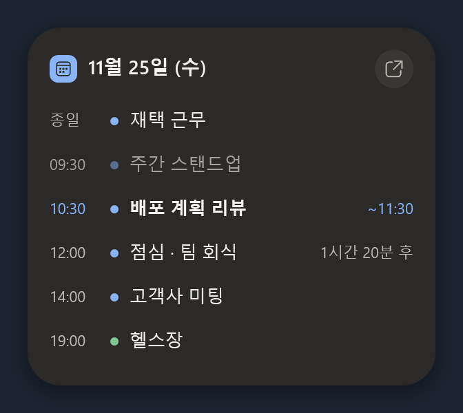

# Today Calendar widget for Windows

A small desktop widget that lists **today's events from every Google account you add**, merged into one list. Click an event to open it in Google Calendar; the button in the corner opens the whole day.

Built on [BWUI](https://github.com/byeonggwan/bwui), a small design system for Windows desktop widgets.

| Light | Dark |
|---|---|
|  |  |

- Shows the calendars each account has ticked in Google Calendar, so it matches what you see there.
- All-day events first, then by time. Finished events are dimmed, the current one is bold with its end time, and the next one says how soon it starts.
- With more than one account, a colored dot marks which account each event is from. An event on two calendars or accounts is shown once.
- Leaves out cancelled events, events you declined, and working-location entries.
- Read-only access. Each account's sign-in is stored encrypted for your Windows user (DPAPI); nothing is sent anywhere except Google.

> Labels follow your Windows display language: Korean, or English for everything else.

## Requirements

Windows 10 or 11. It uses the .NET Framework 4.8 that ships with Windows.

## Install

1. Download `TodayCalendar.exe` from [Releases](https://github.com/byeonggwan/windows-today-calendar-widget/releases).
2. Put it in `%LOCALAPPDATA%\TodayCalendar\` and run it there. Only that copy updates itself.
3. Right-click the widget → **Add Google account** (**구글 계정 추가**) and sign in in the browser. Repeat for each account.

The app is not verified by Google, so the sign-in page says *Google hasn't verified this app*. Choose **Advanced → Go to Today Calendar Widget (unsafe)** to continue. It only asks for read-only calendar access; see [PRIVACY.md](PRIVACY.md).

You stay signed in until you remove the account or revoke access at Google.

### Work accounts

If your company's Google Workspace only allows approved apps, signing in shows *Access blocked … admin_policy_enforced*. Your admin can allow the app (Admin console → Security → API controls); otherwise use the accounts that allow it.

## Build it yourself

Releases have the app's Google OAuth client built in. The repository doesn't, so a build of your own needs a client of its own:

1. In [Google Cloud console](https://console.cloud.google.com/), create a project and enable **Google Calendar API**.
2. **Google Auth Platform**: fill in **Branding** (name, email, home page and privacy policy links), choose **External** under **Audience** and **Publish app**. In *Testing*, Google signs users out every 7 days.
3. **Clients → Create client** of type **Desktop app**, and download its JSON as `oauth-client.json` next to `build.ps1`. It is git-ignored.
4. Build and install:

```powershell
git clone https://github.com/byeonggwan/windows-today-calendar-widget.git
cd windows-today-calendar-widget
powershell -ExecutionPolicy Bypass -File .\build.ps1
Start-Process "$env:LOCALAPPDATA\TodayCalendar\TodayCalendar.exe"
```

A build without `oauth-client.json` asks for a client file instead (right-click → **Choose OAuth client file…**). The release workflow reads the client from the `GOOGLE_CLIENT_ID` and `GOOGLE_CLIENT_SECRET` repository secrets.

## Menu

| Item | Does |
|---|---|
| Open Google Calendar | Today's day view, in the first account |
| Add Google account | Signs in another account in the browser (also re-signs an existing one) |
| Remove account: … | Forgets the account here and revokes the widget's access at Google |
| Choose OAuth client file… | Only in builds without a built-in client: loads a client JSON |
| Refresh / Size / Theme / Start with Windows / Updates / Exit | Standard BWUI items |

Events refresh every 5 minutes (every 10 on battery) and at midnight.

## Files

Data lives in `%LOCALAPPDATA%\TodayCalendar`:

| File | Contents |
|---|---|
| `oauth-client.json` | Only for builds without a built-in client: a copy of the client JSON you chose |
| `accounts.json` | Each account's email and its refresh token, encrypted with DPAPI for your Windows user |
| `settings.txt` | Position, size, theme, update settings |

## Uninstall

1. Right-click → **Remove account** for each account (this revokes access at Google), then **Exit**.
2. Delete `%LOCALAPPDATA%\TodayCalendar` and the `TodayCalendar` value under `HKCU\Software\Microsoft\Windows\CurrentVersion\Run` if you turned on Start with Windows.

## Disclaimer

This is an unofficial community project, not affiliated with or endorsed by Google. Google Calendar is a trademark of Google LLC.

## License

MIT
